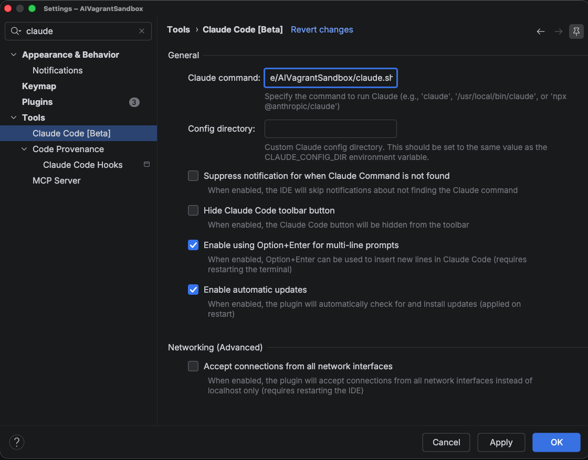
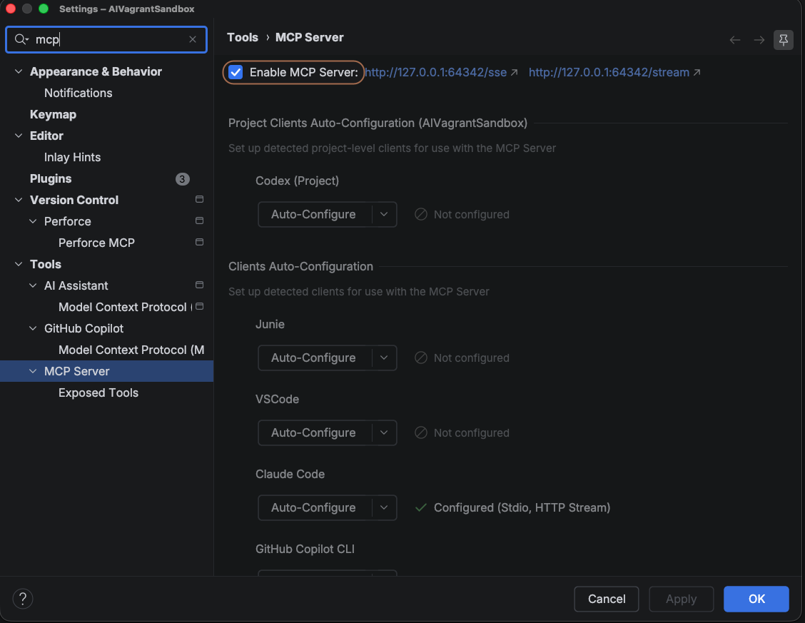

An example AI agent sandbox built with Vagrant.

[Sandboxing local AI Agents](https://octopus.com/blog/local-ai-agent-sandboxes)

# Host environment variables

Credentials are read from the environment of the shell that runs `vagrant up` and written
into the guest as root-owned files under `/etc`, refreshed on every boot.

| Variable | Required | Guest file |
| --- | --- | --- |
| `ANTHROPIC_API_KEY` | yes — `vagrant up` fails without it | `/etc/anthropic_api_key.env` |
| `AZURE_STORAGE_ACCOUNT_KEY` | no | `/etc/azure_storage_account_key.env` |
| `OCTOPUS_API_KEY` | no | `/etc/octopus_api_key.env` |
| `OCTOPUS_APIKEY` | no | `/etc/octopus_apikey.env` |
| `OCTOPUS_URL` | no | `/etc/octopus_url.env` |
| `GITHUB_PACKAGE_READ` | no | `/etc/github_package_read.env` |
| `GH_TOKEN` | no | `/etc/gh_token.env` |
| `OCTOPUS_SERVER_BASE64_LICENSE` | no | `/etc/octopus_server_base64_license.env` |
| `GIT_SERVICE_TOKEN` | no | `/etc/git_service_token.env` |

```bash
export ANTHROPIC_API_KEY='your-key-here'
export AZURE_STORAGE_ACCOUNT_KEY='your-key-here'
export OCTOPUS_API_KEY='your-key-here'
export OCTOPUS_APIKEY='your-key-here'
export OCTOPUS_URL='https://your-instance.octopus.app'
export GITHUB_PACKAGE_READ='your-token-here'
export GH_TOKEN='your-token-here'
export OCTOPUS_SERVER_BASE64_LICENSE='your-base64-license-here'
export GIT_SERVICE_TOKEN='your-token-here'
vagrant up
```

The optional ones are reported and skipped if unset, so the box still comes up without
them. A key that was provisioned earlier is left in place rather than deleted when it is
missing from the host environment; `vagrant up` says so, and the file can be removed in
the guest to revoke it.

The files are root-owned and mode 600, so the `claude` account cannot read them itself.
They are picked up by the root-owned launchers — `/usr/local/sbin/claude-agent` and
`/usr/local/sbin/qwen-agent` — which forward them into the agent's environment and then
drop to that account. Both launchers forward the optional credentials; only
`claude-agent` forwards `ANTHROPIC_API_KEY`, since Qwen has no use for it.

`ANTHROPIC_API_KEY` is additionally denied to Claude Code's own sandboxed Bash tool by
`/etc/claude-code/managed-settings.json`, so a command the agent runs cannot read or leak
it. The optional credentials carry no such rule and are readable by commands the agent
runs — which is what makes them usable from `az` or `octo`, and what to weigh before
adding a key here.

The list itself is `OPTIONAL_HOST_CREDENTIALS` at the top of the `Vagrantfile`, and adding
a variable name to it is all that is needed to expose that variable to the agents. The
guest file name is derived from the name, and the provisioner that writes the file and
both launchers that source it are generated from the same list, so a new entry is written
to `/etc/<name>.env` and forwarded into the environment of every agent on the next
`vagrant provision` or `vagrant reload` (or `vagrant up` for a box that is not running).
Agents already running keep the environment they started with; restart them to pick up
the new variable. The sandbox deny rules are not generated from it, which is the other half of the
point above: a credential added here is readable by commands the agent runs unless it is
also denied in `/etc/claude-code/managed-settings.json`.

# The synced code directory

One host directory is mounted into the guest, and it is the only part of the host the
agents can see. It defaults to `~/Code` and lands at `/home/claude/Code` in the guest.

Not every machine keeps its checkouts there, so the host side is configurable. Set
`AGENT_CODE_DIR` to an absolute path in the environment that runs `vagrant up`:

```bash
export AGENT_CODE_DIR="$HOME/workspace"
vagrant up
```

`vagrant up` stops with a message naming the variable if the directory does not exist,
rather than failing later inside the mount. The guest side stays `/home/claude/Code`
whatever the host side is, so the paths baked into the managed settings and the trust file
do not move; only the host prefix changes, and the `CLAUDE.md` that teaches the agents to
translate between the two prefixes is generated from the same value.

The launcher scripts read `AGENT_CODE_DIR` too, and they need the same answer the
`Vagrantfile` had when the box came up: they translate the directory the IDE launched
them from into its guest equivalent, and a mismatch would send the agent to the root of
the synced tree instead. Exporting it from your shell profile keeps the two in step. Each
launcher finds the `Vagrantfile` beside itself, so the clone can live anywhere on the
host — including outside the synced directory.

# Running Claude Code in a JetBrains IDE

The `claude.sh` or `claude.ps1` script is expected to be called by the IDE when launching Claude Code.

# Updating Claude Code

Update Claude Code with:

```bash
vagrant ssh
sudo npm update -g @anthropic-ai/claude-code
```

# Running QWEN

Run `qwen.sh` or `qwen.ps1` to launch QWEN Code.

Both scripts accept optional override arguments that update the agent's configuration
(`modelProviders.openai[0]`) in the guest's `~/.qwen/settings.json`:

| Argument | Type | Description |
| --- | --- | --- |
| `--model NAME` | string | Override the model name (e.g. `gpt-oss:20b`) |
| `--reasoning-effort VALUE` | enum | Set reasoning effort: `none`, `low`, `medium`, `high`, or `max` |
| `--context-window-size INTEGER` | integer | Override the context window size |
| `--ollama-host HOST` | string | Override the Ollama server (default from settings.json) |
| `--disable-external-access` | flag | Block the agent's network access except loopback (see below) |

```bash
# Launch with a specific model and reasoning effort
./qwen.sh --model gpt-oss:20b --reasoning-effort high

# Launch with a custom context window size and Ollama host
./qwen.ps1 --context-window-size 128000 --ollama-host 192.168.1.100
```

## Disabling external access

`--disable-external-access` adds guest firewall rules (iptables/ip6tables) that reject all
new outbound connections except over the loopback interface, for the length of the session.
Only `root` and `vagrant` are exempt, so processes run by other accounts can't be used to
get around it. SSH keeps working, as do all the forwarded ports (the `-R` ports
and the `-L` port), because they are loopback traffic in the guest. The rules are removed when
the session ends. DHCP lease renewal is blocked while they are in place. If the rules cannot be installed, the agent is not started.

Because only loopback is allowed, an `--ollama-host` pointing at another machine will be
unreachable; leave Ollama on the host's localhost via the `11434` forward instead. Concurrent
sessions share the rules, so the first one to exit lifts them for the others.

Arguments are left alone when not passed, which is how the IDE typically calls these scripts.
An unrecognized argument causes an error and non-zero exit.

# Configuring IDE MCP server

> [!WARNING]
> The port that the IntelliJ MCP server listens on is unique to each host. The port in `claude.sh` or `claude.ps1` must be updated to match the port that the MCP server is listening on.

In InteliJ IDEA and other JetBrains IDEs, you can configure the script to be called by navigating to Tools > Claude Code > Claude Command.



Enable the MCP server by navigating to Tools > MCP Server.



# Bazzite setup

The following dependencies are required for the vagrant libvirt provider:

```
rpm-ostree install \
  qemu-kvm \
  libvirt-daemon-driver-qemu \
  libvirt-daemon-config-network \
  libvirt-daemon-driver-network \
  libvirt-daemon-driver-storage-core \
  libvirt-client \
  libvirt-devel ruby-devel libxslt-devel libxml2-devel

vagrant plugin install vagrant-libvirt

grep -E '^libvirt:' /etc/group || grep -E '^libvirt:' /usr/lib/group | sudo tee -a /etc/group
sudo usermod -aG libvirt "$USER"
sudo systemctl enable --now virtqemud.socket virtnetworkd.socket virtstoraged.socket

sudo firewall-cmd --zone=libvirt --add-service=nfs --add-service=rpc-bind --add-service=mountd --permanent
sudo firewall-cmd --reload
sudo systemctl enable --now nfs-server


```